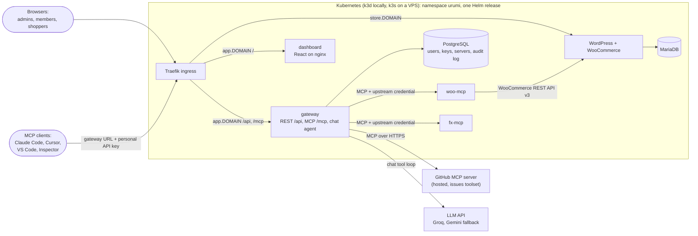
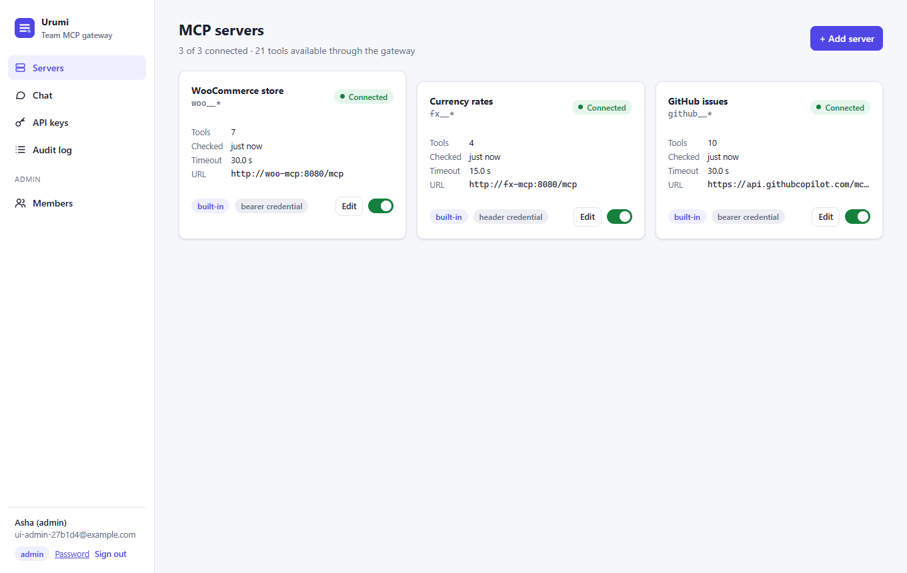
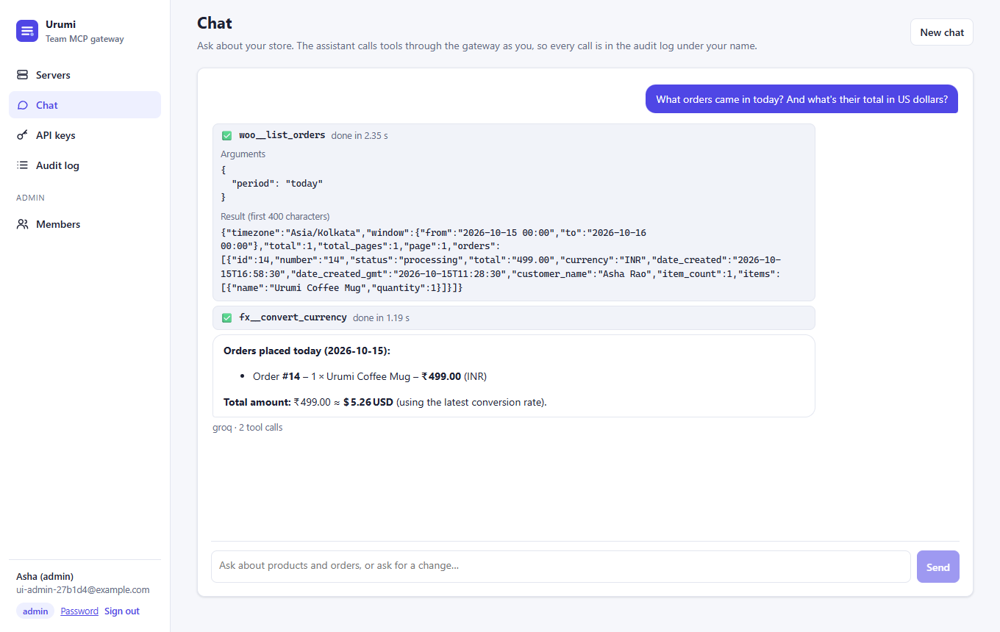
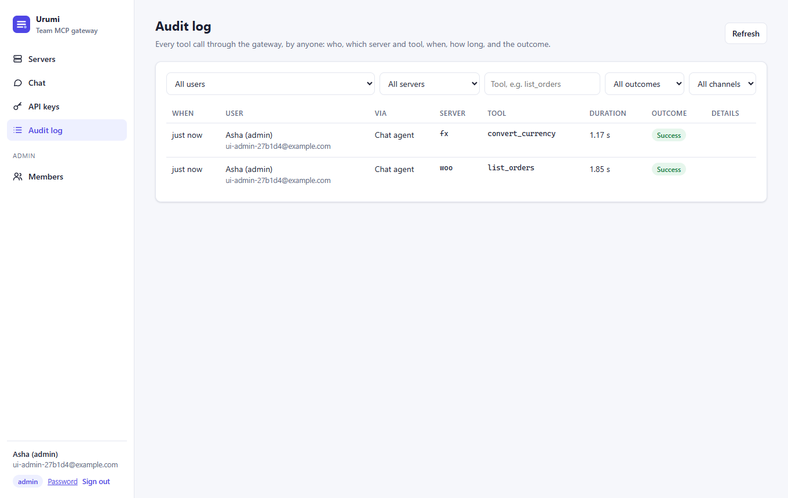
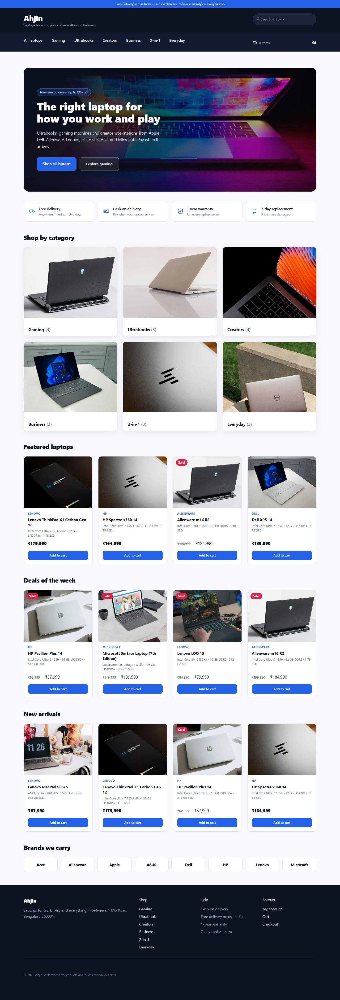
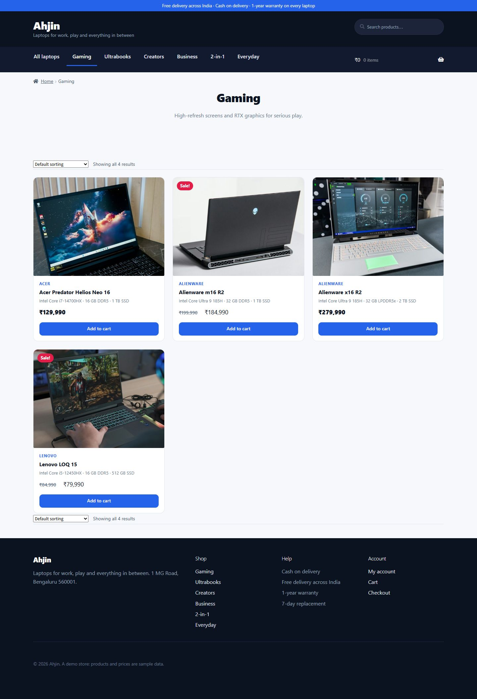
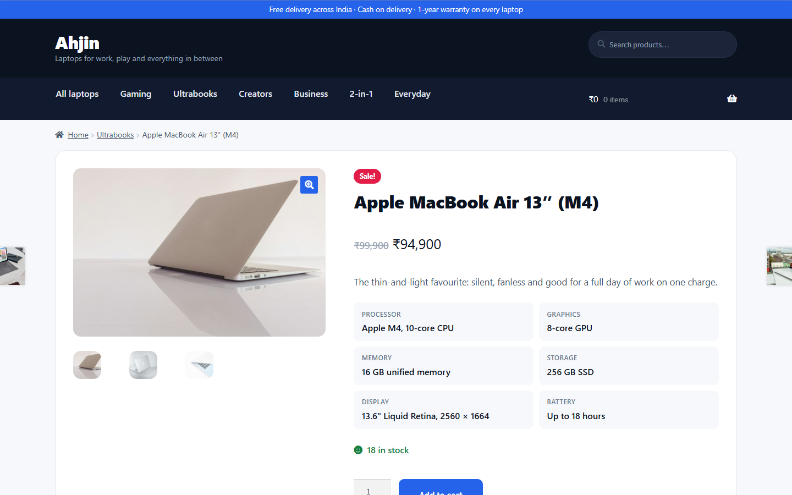
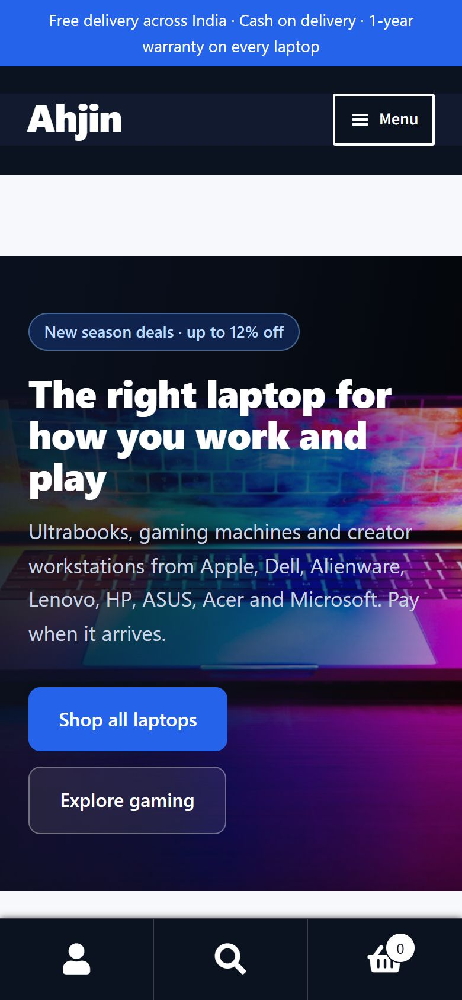

# Merchant MCP Gateway

[](https://github.com/Mohan0112/Merchant_MCP_gateway/actions/workflows/ci.yml)

WooCommerce hosting with a **team MCP gateway** on Kubernetes, built for the Urumi AI FDE internship take-home (Round 1, "MCP Gateway on Kubernetes").

An admin registers MCP servers once in a dashboard. Every team member then uses all of their tools through **one MCP endpoint and one personal API key**, from Claude Code, Cursor, VS Code or MCP Inspector, or through a **chat agent** in the dashboard. A WooCommerce store in the same cluster is the first data source, exposed by an MCP server written for this project. Upstream credentials never leave the server side, and every tool call is audited under the person who made it.

**Status:** the core is complete. `task dod` runs the brief's whole definition of done against the running cluster and passes all 19 checks, and CI is green on `main`. Work beyond the core is listed under [Extras and stand-out items](#extras-and-stand-out-items).

## For reviewers

Every line of the brief, with where it is implemented and how it was verified: [docs/brief-checklist.md](docs/brief-checklist.md).

| The brief asks for                                                      | Where it is                                                                                                      |
| ----------------------------------------------------------------------- | ---------------------------------------------------------------------------------------------------------------- |
| Local setup instructions                                                | [Local setup](#local-setup)                                                                                      |
| VPS or production-like setup                                            | [Production-like and VPS setup](#production-like-and-vps-setup) and [docs/runbooks/vps.md](docs/runbooks/vps.md) |
| Placing an order, connecting an MCP client, using the chat agent        | [Using it](#using-it)                                                                                            |
| Source of the dashboard, gateway, WooCommerce MCP server and chat agent | `apps/dashboard`, `apps/gateway` (chat agent in `src/modules/chat`), `apps/woo-mcp`                              |
| Helm charts and values files                                            | `charts/urumi`, with `values-local.yaml` and `values-prod.yaml`                                                  |
| System design and tradeoffs                                             | [docs/system-design.md](docs/system-design.md)                                                                   |
| Threat model                                                            | [docs/threat-model.md](docs/threat-model.md)                                                                     |
| Bonus and stand-out items attempted                                     | [Extras and stand-out items](#extras-and-stand-out-items)                                                        |
| The definition of done, end to end                                      | [Definition of done](#definition-of-done)                                                                        |

## Architecture



- **gateway** (Node.js, Fastify) is the only component that talks to upstream MCP servers. It is an MCP client of every enabled server and an MCP server itself: `tools/list` returns the tools of every enabled server, and `tools/call` is routed to the right server with that server's own credential and timeout. It also serves the dashboard's REST API, keeps users, keys, servers and the audit log in PostgreSQL, and runs the chat agent.
- **woo-mcp** (written for this project) exposes the store's products and orders as tools. **fx-mcp** (also ours) converts currencies. The third upstream is GitHub's hosted MCP server, outside the cluster.
- **Public versus internal:** only Traefik is exposed. woo-mcp and fx-mcp have no Ingress, and NetworkPolicies admit only the gateway to them. Every other workload is behind a default-deny ingress policy with explicit allow rules.
- **One tool call from Claude Code:** client → Traefik → gateway `/mcp` (API key checked) → routed by the tool's prefix → woo-mcp, with the gateway's credential → WooCommerce REST API → MariaDB, and back. The gateway writes an audit row for the call.

### What runs where

Everything is in namespace `urumi`, installed as one Helm release `urumi` from the umbrella chart `charts/urumi`.

| Workload                     | Kind                     | Exposed as                            | Storage               |
| ---------------------------- | ------------------------ | ------------------------------------- | --------------------- |
| `wordpress`                  | Deployment               | Ingress `store.<domain>`              | PVC `wp-uploads`      |
| `mariadb`                    | StatefulSet              | internal only                         | PVC `data-mariadb-0`  |
| `store-bootstrap`, `wp-cron` | Job (Helm hook), CronJob | not exposed                           | none                  |
| `woo-mcp`, `fx-mcp`          | Deployment               | internal, gateway only                | none                  |
| `gateway`                    | Deployment               | Ingress `app.<domain>/api` and `/mcp` | none                  |
| `dashboard`                  | Deployment               | Ingress `app.<domain>/`               | none                  |
| `postgres`                   | StatefulSet              | internal only                         | PVC `data-postgres-0` |

Every long-running workload has readiness and liveness probes, and every container has resource requests and limits and runs as non-root. Credentials live in Kubernetes Secrets created by `scripts/secrets.mjs`; the chart refers to them by name only.

## Quick tour

| Servers, with status and tools                                                | Chat agent using two servers                                                                       | Audit log                                                   |
| ----------------------------------------------------------------------------- | -------------------------------------------------------------------------------------------------- | ----------------------------------------------------------- |
|  |  |  |

The store is **Ahjin**, a laptop shop: 19 laptops from eight brands in six categories, on a Storefront child theme (`docker/wordpress/theme/ahjin`) with the catalogue seeded from `docker/wordpress/catalog`.

| Home page                                                                       | A category                                               | Product page                                                                   | Phone                                                        |
| ------------------------------------------------------------------------------- | -------------------------------------------------------- | ------------------------------------------------------------------------------ | ------------------------------------------------------------ |
|  |  |  |  |

## What's in the repo

| Path                      | What it is                                                                                                                                                              |
| ------------------------- | ----------------------------------------------------------------------------------------------------------------------------------------------------------------------- |
| `apps/gateway`            | Fastify backend: REST API for the dashboard (`/api`), the aggregating MCP endpoint (`/mcp`), upstream connections and health checks, audit log, chat agent              |
| `apps/dashboard`          | React 19 + Vite dashboard, served by nginx-unprivileged                                                                                                                 |
| `apps/woo-mcp`            | The WooCommerce MCP server: six store tools plus `server_info`                                                                                                          |
| `apps/fx-mcp`             | A second MCP server for currency rates and conversion                                                                                                                   |
| `packages/mcp-kit`        | What every MCP server here shares: Streamable HTTP, static credential check, Host allow-list, health probes                                                             |
| `packages/contracts`      | Zod schemas and types shared by the dashboard, gateway and MCP servers                                                                                                  |
| `packages/logger`         | pino logger with central secret redaction                                                                                                                               |
| `charts/urumi`            | Umbrella Helm chart; sub-charts `store`, `mcp-server` (used twice, as `woo-mcp` and `fx-mcp`) and `platform`; values for local, production and the production rehearsal |
| `docker/`                 | Images: WordPress + WooCommerce with the bootstrap script, one shared image recipe for the Node services, the dashboard                                                 |
| `deploy/k3d/cluster.yaml` | The local cluster: 1 server and 1 agent on k3s v1.35.5, plus a local registry                                                                                           |
| `scripts/`                | `secrets.mjs` (Secrets from `.env.local`), `dod-check.mjs` (the definition of done), `verify-k8s.mjs` (chart checks), `demo-reset.mjs` (clean demo state)               |
| `.github/workflows/`      | CI (lint, typecheck, tests, build, chart checks, gitleaks), image publishing to GHCR, chart release on `v*` tags                                                        |
| `docs/`                   | Design notes, threat model, demo script, runbooks, ADRs, build log and project plan ([index](#documentation))                                                           |
| `Taskfile.yml`            | Every developer workflow; `task --list` shows them all                                                                                                                  |

## Prerequisites

Verified on Windows 11 with Docker Desktop on WSL2. macOS and Linux should work with the same tools but haven't been tested. On Windows, run the commands in **Git Bash**: some tasks call POSIX tools such as `base64`.

| Tool           | Verified with | Notes                                                                      |
| -------------- | ------------- | -------------------------------------------------------------------------- |
| Docker Desktop | Engine 29.8.2 | The running stack uses about 2 GB of memory; image builds need more on top |
| k3d            | 5.9.0         | Runs k3s v1.35.5 in Docker                                                 |
| kubectl        | 1.36          |                                                                            |
| Helm           | 4.3.1         | Helm 4: the runbooks use flags such as `--rollback-on-failure`             |
| Task           | 3.54.0        | [taskfile.dev](https://taskfile.dev)                                       |
| Node.js        | 24.19.0       | See `.nvmrc`                                                               |
| pnpm           | 12.11.2       | Pinned by `packageManager` in `package.json`                               |

Host ports 80 and 443 (Traefik) and 5001 (local registry) must be free. For the chat agent you need a free Groq or Gemini API key, and for the third upstream a GitHub fine-grained token; the rest of the stack runs without them.

## Local setup

Run everything from the repository root.

### 1. Install and configure

```sh
git clone https://github.com/Mohan0112/Merchant_MCP_gateway.git
cd Merchant_MCP_gateway
pnpm install
cp .env.example .env.local
```

Fill in `.env.local`. It is git-ignored; never commit it. Random secrets (database passwords, the credential encryption key, the API-key pepper, WordPress salts) are generated for you, so they aren't in the file.

| Variable                                  | Used for                                                                                                     | Needed?                                         |
| ----------------------------------------- | ------------------------------------------------------------------------------------------------------------ | ----------------------------------------------- |
| `ADMIN_EMAIL`                             | The first dashboard admin                                                                                    | Required                                        |
| `ADMIN_PASSWORD`                          | That admin's first password, at least 12 characters                                                          | Optional: generated when empty                  |
| `WP_ADMIN_EMAIL`                          | The wp-admin account                                                                                         | Required                                        |
| `WP_ADMIN_USER`, `WP_ADMIN_PASSWORD`      | The wp-admin login                                                                                           | Optional: `storeadmin` and a generated password |
| `GROQ_API_KEY`                            | Chat agent ([console.groq.com/keys](https://console.groq.com/keys), free)                                    | For the chat (this or `GEMINI_API_KEY`)         |
| `GEMINI_API_KEY`                          | Chat fallback ([aistudio.google.com/apikey](https://aistudio.google.com/apikey), free)                       | Optional                                        |
| `GITHUB_MCP_PAT`                          | Third upstream, GitHub's hosted MCP server: a fine-grained token with Issues read and write on one demo repo | For the third server                            |
| `GITHUB_USERNAME`, `GITHUB_MCP_DEMO_REPO` | The demo repo that token can reach                                                                           | Optional                                        |

The remaining variables (`GITHUB_REPO`, `VPS_*`, `DUCKDNS_*`, `LETSENCRYPT_EMAIL`) aren't used locally.

### 2. Create the cluster and deploy

```sh
task cluster:up      # k3d cluster "urumi" (1 server + 1 agent) and a registry on localhost:5001
task secrets         # create the Kubernetes Secrets from .env.local; values are never printed
task images:build    # build the five images and push them to the local registry
task deploy:local    # helm upgrade --install with values-local.yaml, then wait for every rollout
task logins          # print the wp-admin and dashboard logins (local use only)
```

The first run downloads the base images; the store image alone is about 1.4 GB. `task deploy:local` waits for the store bootstrap Job, which installs WordPress and WooCommerce, enables cash on delivery, creates the `mcp-bot` user that woo-mcp signs in as, seeds the Ahjin laptop catalogue (19 laptops with photos and specifications) and activates the Ahjin storefront theme. `task secrets` is safe to re-run: generated values are created once, and values from `.env.local` are applied again each time (run `task deploy:local` afterwards so pods pick them up).

### 3. Open it

| URL                             | What it is                                      |
| ------------------------------- | ----------------------------------------------- |
| http://store.127.0.0.1.nip.io   | Storefront, with the store admin at `/wp-admin` |
| http://app.127.0.0.1.nip.io     | Dashboard                                       |
| http://app.127.0.0.1.nip.io/mcp | The gateway's MCP endpoint, for MCP clients     |

`*.127.0.0.1.nip.io` resolves to `127.0.0.1`, so there's nothing to add to the hosts file ([docs/local-domains.md](docs/local-domains.md)). Sign in to the dashboard with the login from `task logins`. The first sign-in makes you choose a new password; after that, `task logins` still prints the initial one, which no longer works. The Servers page should show `woo` (7 tools), `fx` (4) and `github` (10) as Connected.

### 4. Check the definition of done

```sh
task dod                   # the brief's definition of done, end to end
task dod -- --skip-chat    # the same without the steps that need an LLM key
```

It never touches your accounts: it creates a temporary admin, invites users A and B, and at the end removes them, their keys and audit rows, and its test orders and products. It briefly disables `fx` and scales `fx-mcp` to zero, so don't run it in the middle of a demo.

### Day-to-day development

```sh
task check                    # lint, typecheck and test every package
task image:node APP=gateway   # rebuild one Node service: gateway, woo-mcp or fx-mcp
task image:dashboard          # rebuild the dashboard (task image:wordpress for the store)
task deploy:local             # upgrade the release; Deployments restart to pull the new :dev images
task chart:lint               # helm lint and render with the local and production values
task verify:k8s               # probes, resources, non-root and NetworkPolicies in the rendered chart, plus kubeconform
task store:bootstrap-logs     # what the last store bootstrap did
```

The gateway's database tests run only when `TEST_DATABASE_URL` points at a PostgreSQL; CI provides one, and [docs/BUILD_LOG.md](docs/BUILD_LOG.md#resume-or-debug) shows how to start one locally. `k3d cluster stop urumi` frees the cluster's memory while you're not using it, and `k3d cluster start urumi` brings it back with its data. `task cluster:down` deletes the cluster and everything in it.

## Using it

### Place an order

1. Open http://store.127.0.0.1.nip.io/shop/. It lists the Ahjin laptop catalogue: 19 laptops from Apple, Dell, Alienware, Lenovo, HP, ASUS, Acer and Microsoft in six categories (Gaming, Ultrabooks, Creators, Business, 2-in-1, Everyday), each with photos, specifications and stock.
2. Open one and click **Add to cart**, then **View cart** and **Proceed to checkout**.
3. Fill in the billing details: any name, an address in India, an email and a phone number. There is no shipping step; shipping is turned off on purpose.
4. Choose **Cash on delivery** and click **Place order**.
5. Open http://store.127.0.0.1.nip.io/wp-admin/, sign in with the wp-admin login from `task logins`, and go to **WooCommerce → Orders**. The order is listed as **Processing**.

### Invite a teammate and create an API key

- **Invite (admin):** in **Members → Invite a teammate**, enter an email, pick a role (a member uses tools; an admin also manages servers and members) and click **Create invitation**. Send the one-time link to your teammate; it's valid for 72 hours and no email is sent. They open it, choose a name and password, and are signed in.
- **Create a key (anyone):** in **API keys → New key**, name the key (for example "Claude Code on laptop"), optionally pick an expiry, and click **Create key**. The key (`umcp_…`) is shown once, together with ready-to-paste settings for Claude Code, Cursor, VS Code and MCP Inspector. The gateway keeps only a hash of it. Admins can also issue and revoke a member's keys from **Members → API keys**.

### Connect an external MCP client

A client needs only the gateway URL and a key: `http://app.127.0.0.1.nip.io/mcp` locally or `https://app.<domain>/mcp` in production, with the header `Authorization: Bearer <key>`. None of the upstream servers is configured in the client. These are the settings the dashboard generates.

**Claude Code** (run in a terminal):

```sh
claude mcp add --transport http urumi http://app.127.0.0.1.nip.io/mcp --header "Authorization: Bearer <your key>"
```

**Cursor** (`~/.cursor/mcp.json`):

```json
{
  "mcpServers": {
    "urumi": {
      "url": "http://app.127.0.0.1.nip.io/mcp",
      "headers": {
        "Authorization": "Bearer <your key>"
      }
    }
  }
}
```

**VS Code** (`.vscode/mcp.json`):

```json
{
  "servers": {
    "urumi": {
      "type": "http",
      "url": "http://app.127.0.0.1.nip.io/mcp",
      "headers": {
        "Authorization": "Bearer <your key>"
      }
    }
  }
}
```

**MCP Inspector** (start it with `npx @modelcontextprotocol/inspector`):

```text
Transport: Streamable HTTP
URL: http://app.127.0.0.1.nip.io/mcp
Header: Authorization = Bearer <your key>
```

Tools are named `<server>__<tool>`, for example `woo__list_orders`, `fx__convert_currency` and `github__list_issues`: 21 tools from three servers. Try:

- `What orders came in today?` uses `woo__list_orders`.
- `What is today's order total in US dollars?` uses `woo__list_orders` and then `fx__convert_currency`, two upstream servers in one prompt.

Calls made with a key are logged under its owner, with channel `mcp_client`. When an admin disables or enables a server, Claude Code is notified (`tools/list_changed`) and updates its tool list straight away; MCP Inspector shows the change the next time you click **List Tools**.

### Use the chat agent

Open **Chat** in the dashboard and ask in plain language. The agent calls the same tools through the gateway's own `/mcp` endpoint **as you**, with a short-lived token tied to your session, so authentication, routing and the audit log work exactly as for an external client (channel `chat_agent`). Each tool call is shown as a card with its arguments, a preview of the result and its duration.

The brief's flow for user A:

1. `Create a product named "Ahjin Laptop Sleeve 14" with a regular price of 1499.` The agent calls `woo__create_product`, and the product is on http://store.127.0.0.1.nip.io/shop/ straight away.
2. Order that product on the storefront by hand, then ask `What orders came in today?`. The agent calls `woo__list_orders` with `period: today`, which woo-mcp works out in the store's timezone (Asia/Kolkata), and lists the order.

The model is Groq's `openai/gpt-oss-120b`, with Google's `gemini-2.5-flash` as the fallback when Groq fails or rate-limits. A turn runs at most 8 rounds of the tool loop and 120 seconds.

### Audit log

**Audit log** lists every tool call, from MCP clients and from the chat agent: who, which server and tool, when, how long, and the outcome (`success`, `tool_error`, `timeout`, `upstream_unreachable`, `rejected_disabled`, `denied_auth` or `not_found`). A call with a revoked key is logged too, under the key's owner. Admins see everyone's calls and can filter by user, server, tool, outcome and channel; members see only their own.

### Manage servers (admin)

**Servers → + Add server** registers any MCP server that speaks Streamable HTTP: a name, a slug (the tool-name prefix), the URL, an optional credential (a bearer token or a named header) and a timeout. **Test connection** tries it before you save. Each card shows the status (Connected, Unreachable with the reason, or Disabled) and has **Edit** and an enable switch; click a card for its tools, **Reconnect now** and **Remove server**. Credentials are write-only: they're encrypted at rest and never sent back to a browser or an MCP client. Members see the servers and their tools, but not URLs or credentials.

### Team and control

- **Revoke a key:** **Revoke** next to it in **API keys** (or in **Members → API keys**). The next request with that key gets `401` and is logged as `denied_auth`. The MCP endpoint authenticates every request, so there's no session that outlives the key.
- **Disable a server:** the switch on its card. Its tools disappear for every client and for the chat agent, and a direct call returns a clear "disabled by an admin" error.
- **Kill an upstream:** the dashboard shows the server as Unreachable with the reason, calls to it fail fast with a clear error, and the other servers keep working. It reconnects by itself when it comes back.

```sh
kubectl -n urumi delete pod -l app.kubernetes.io/name=fx-mcp    # the Deployment starts a new pod within seconds
kubectl -n urumi scale deployment fx-mcp --replicas=0           # or keep it down for a while (what task dod does)
kubectl -n urumi scale deployment fx-mcp --replicas=1           # and bring it back
```

[docs/demo-script.md](docs/demo-script.md) walks through the whole flow with two users. `task demo:reset` restores a clean demo state and creates demo users A and B.

## Production-like and VPS setup

The same chart installs on k3s on a VPS; only the values files change. k3d is k3s in Docker, so both environments have the same Traefik ingress, `local-path` storage and NetworkPolicy enforcement.

| Concern                | `values-local.yaml`                          | `values-prod.yaml`                                                                                      |
| ---------------------- | -------------------------------------------- | ------------------------------------------------------------------------------------------------------- |
| Domain                 | `127.0.0.1.nip.io`, so no DNS setup          | Your domain, for example a DuckDNS subdomain: `store.<domain>`, `app.<domain>`                          |
| TLS                    | Off (`http`)                                 | `https`, with certificates from cert-manager and a Let's Encrypt `ClusterIssuer` that the chart renders |
| Images                 | Local registry, tag `dev`, pulled every time | `ghcr.io/mohan0112/merchant_mcp_gateway/<app>` with an immutable git-SHA tag built by CI                |
| Storage (`local-path`) | MariaDB 2 Gi, uploads 1 Gi, PostgreSQL 1 Gi  | MariaDB 10 Gi, uploads 5 Gi, PostgreSQL 5 Gi                                                            |
| Resources              | Lean limits for a laptop                     | Higher limits: gateway and WordPress 768 Mi, MariaDB and PostgreSQL 1 Gi                                |
| Secrets                | `task secrets` against `k3d-urumi`           | The same script against the VPS's kube context                                                          |
| Log level              | `debug`                                      | `info`                                                                                                  |

Session cookies get the `Secure` flag automatically over HTTPS. CI renders the chart with both values files on every push.

### Rehearse production on the laptop

The production values are proven on a throwaway single-node k3s cluster (like the VPS) that uses `values-prod.yaml` plus `values-rehearsal.yaml`. The only differences from production are the nip.io domain and a self-signed issuer instead of Let's Encrypt, which can't reach a laptop:

```sh
task rehearsal:up       # stops the local cluster, creates k3d cluster "urumi-rehearsal" with cert-manager
task rehearsal:deploy   # the chart with the production values and the images CI pushed to GHCR
task rehearsal:dod      # the definition-of-done check over HTTPS
task rehearsal:down     # deletes the rehearsal cluster and starts the local one again
```

Last run (2026-10-19): the definition of done passed 19 of 19 over HTTPS, and an upgrade, a manual `helm rollback` and a broken upgrade that Helm rolled back automatically (the gateway answered every request throughout) are recorded in [docs/runbooks/upgrade-and-rollback.md](docs/runbooks/upgrade-and-rollback.md#drill).

### Deploy to a VPS

The full runbook is [docs/runbooks/vps.md](docs/runbooks/vps.md). In short:

1. **Server:** an x86-64 VPS (CI publishes amd64 images) running Ubuntu 24.04, with ports 80 and 443 open, SSH by key only, and the Kubernetes API port (6443) closed to the internet.
2. **k3s**, the same version as the local cluster: `curl -sfL https://get.k3s.io | INSTALL_K3S_VERSION=v1.35.5+k3s1 sh -`. It brings Traefik, `local-path` storage and NetworkPolicy enforcement.
3. **DNS:** point `store.<domain>` and `app.<domain>` at the server's IP address.
4. **cert-manager**, from its official Helm chart: `task cert-manager KUBE_CONTEXT=<vps-context>`.
5. **Secrets**, from your laptop with the VPS's kube context: `node scripts/secrets.mjs --context=<vps-context>`.
6. **Deploy** with `task deploy:prod PROD_CONTEXT=<vps-context> DOMAIN=<domain> LETSENCRYPT_EMAIL=<email>`, which installs the chart with `values-prod.yaml` and the images CI built for `origin/main` (Let's Encrypt staging first: add `ISSUER=letsencrypt-staging`).
7. **Check** with `node scripts/dod-check.mjs --context=<vps-context> --domain=<domain> --scheme=https`, then connect Claude Code to `https://app.<domain>/mcp`.

The live VPS deployment itself is deferred (planned as Task 31); the rehearsal above proves the production values and the runbook.

### Upgrades and rollback

Each environment is one Helm release, so `helm -n urumi history urumi` lists every revision, and a rollback returns the whole platform to a known-good set of image tags and settings:

```sh
helm -n urumi history urumi
helm -n urumi rollback urumi <revision> --wait
```

Production upgrades use immutable image tags and `helm upgrade --rollback-on-failure` (Helm 4's replacement for `--atomic`), so a release whose pods don't become ready is rolled back automatically. Database migrations follow expand and contract: a release only adds tables and columns, and removals ship a release later, so the previous gateway still works after a rollback. Helm can't undo WooCommerce's own database updates, so take a database backup before upgrading WooCommerce. Details are in [docs/runbooks/upgrade-and-rollback.md](docs/runbooks/upgrade-and-rollback.md).

## Definition of done

`task dod` (`scripts/dod-check.mjs`) checks the brief's definition of done against the running cluster, through the public URLs:

| The brief's check                                                                                                                                    | How `task dod` checks it                                                                                                       |
| ---------------------------------------------------------------------------------------------------------------------------------------------------- | ------------------------------------------------------------------------------------------------------------------------------ |
| Storefront checkout with cash on delivery; the order is in WooCommerce admin                                                                         | Checks out through the WooCommerce Store API (the calls the checkout page makes), then reads the order back as the store admin |
| User A: the agent creates a product, and it appears on the storefront                                                                                | A chat turn must call `woo__create_product`; the product must then be on the storefront                                        |
| User A: an order placed by hand, then "what orders came in today?"                                                                                   | Places a storefront order, then the chat answer must name it                                                                   |
| User B: a client with only the URL and a key sees every enabled server's tools, answers the orders question, and runs one request across two servers | An MCP client with B's key lists the tools, calls `woo__list_orders`, then `woo__get_order` and `fx__convert_currency`         |
| Revoke B's key; the next call is rejected                                                                                                            | Revokes the key; the next request must fail                                                                                    |
| Disable a server; its tools disappear from the chat and the client                                                                                   | Disables `fx`, checks the client's tool list, a direct call and a chat turn, then enables it again                             |
| Kill an upstream; the others keep working and the dashboard shows it unreachable                                                                     | Scales `fx-mcp` to zero; `fx` must turn Unreachable while `woo` still answers, then reconnect                                  |
| Every call is in the audit log under the right user                                                                                                  | Checks A's and B's entries, outcomes and channels, and that a member sees only their own                                       |

It also checks that at least three upstreams are connected and that members never see upstream URLs or credentials. The browser half (checkout in the UI, Claude Code, the dashboard pages) is a checklist in [docs/runbooks/dod-manual.md](docs/runbooks/dod-manual.md). CI runs lint, typecheck, unit and integration tests (the gateway's against a real PostgreSQL), the build, chart lint and render with both values files, `task verify:k8s` and a gitleaks scan of the full history.

## Security in brief

- **API keys** look like `umcp_<prefix>_<secret>`, are shown once and are stored only as an HMAC-SHA256 with a server-side pepper. Revocation applies to the very next request.
- **Dashboard sign-in:** scrypt password hashes; an opaque session cookie (HttpOnly, SameSite=Lax, Secure over HTTPS) of which only a hash is stored; login throttling; an anti-CSRF header on every state-changing call.
- **Upstream credentials** are encrypted at rest with AES-256-GCM and are write-only in the API. Only the gateway sends them, and only to their own server. They never reach a browser or an MCP client.
- **Client tokens are never passed through** to upstream servers; each upstream receives only its own static credential.
- **Roles:** admins manage servers, members and everyone's keys. Members use the tools, manage their own keys and see their own audit entries; they see no upstream URLs or credentials.
- **Untrusted upstreams:** tool descriptions are prefixed with the server's name and capped at 2,000 characters, and the chat agent treats tool output as data, not instructions. A malicious server only ever sees its own credential and the calls made to its tools.
- **Kubernetes:** only Traefik is exposed; default-deny ingress NetworkPolicies with an allow rule per workload; every container non-root with all capabilities dropped; no component talks to the Kubernetes API, so there are no RBAC grants. Secrets come from a git-ignored file, and gitleaks scans the history in CI.

The full analysis, including what one team member can do to another, is in [docs/threat-model.md](docs/threat-model.md).

## Design notes

[docs/system-design.md](docs/system-design.md) covers the architecture choices, tool aggregation, routing and failure handling, and what changes for production. The questions the brief asks to document:

- **Tool-name collisions:** every tool is exposed as `<slug>__<tool>`. Slugs are 2 to 20 lowercase letters, digits or dashes and never contain `_`, so the first `__` always splits a name and no server can shadow another's tool. woo and fx both have a `server_info` tool; clients see `woo__server_info` and `fx__server_info`.
- **How woo-mcp talks to the store:** the WooCommerce REST API v3, as a dedicated `mcp-bot` user with the `shop_manager` role, over the in-cluster Service with HTTP Basic Auth and a REST key from a Kubernetes Secret. The REST API runs WooCommerce's own validation and hooks and needs no Kubernetes permissions; WP-CLI through `kubectl exec` would need `pods/exec`, and direct SQL would bypass WooCommerce. See [ADR-0002](docs/adr/0002-woocommerce-rest-basic-auth.md).
- **Local domains:** `*.127.0.0.1.nip.io` resolves to `127.0.0.1` and k3d maps ports 80 and 443 to Traefik, so the URLs work with no hosts-file edits. There's a hosts-file fallback for offline use. See [docs/local-domains.md](docs/local-domains.md).
- **Slow or dead upstreams:** `tools/list` is answered from a catalog kept in memory, so it never waits on an upstream. Every call has its server's own timeout (by default 30 s for woo and github, 15 s for fx). Health checks every 10 seconds mark a server Unreachable with a reason (DNS, connection refused, timeout, TLS, credential rejected, HTTP error or protocol), calls to it then fail fast with a clear error, and reconnects back off from 1 to 30 seconds.
- **A stateless MCP endpoint** on the MCP TypeScript SDK v2: every request is authenticated on its own, so nothing is lost on restart. See [ADR-0003](docs/adr/0003-mcp-sdk-v2-stateless-gateway.md).

## Troubleshooting

- **The URLs don't load.** Check the cluster is running (`k3d cluster list`), that nothing else holds port 80 (in PowerShell: `Get-NetTCPConnection -LocalPort 80 -State Listen`) and that nip.io resolves (`nslookup store.127.0.0.1.nip.io`). Offline, use the hosts-file fallback in [docs/local-domains.md](docs/local-domains.md).
- **A pod is stuck in `CreateContainerConfigError`.** A Secret or key is missing: run `task secrets`, then `kubectl -n urumi describe pod <pod>`.
- **A pod is stuck in `ImagePullBackOff`.** The image isn't in the local registry: run `task images:build`. Images are pushed to `localhost:5001/…` and pulled as `urumi-registry:5000/…`.
- **No products, or a "Coming soon" page.** `task store:bootstrap-logs` shows what the bootstrap did; `task deploy:local` runs it again, and it only does what's missing.
- **The chat says no LLM provider is configured, or keeps failing.** Set `GROQ_API_KEY` (and optionally `GEMINI_API_KEY`) in `.env.local`, then run `task secrets` and `task deploy:local` so the gateway restarts with it.
- **Only two servers are listed.** The GitHub server is registered only when `GITHUB_MCP_PAT` is set. Set it, then run `task secrets` and `task deploy:local`; the gateway registers it when it starts.
- **`helm upgrade` fails with a field-ownership conflict naming `kubectl`.** A Helm-managed object was edited by hand with `kubectl edit` or `patch`. Don't do that; recover once with `helm upgrade … --force-conflicts`.
- **Tools aren't found right after installing them with winget.** Open a new terminal, or restart VS Code if you use its terminal.
- **Docker or WSL memory is near its limit.** The running stack uses about 2 GB: two k3d nodes at about 0.9 GB each (`docker stats --no-stream`, `kubectl -n urumi top pods`). WSL's memory figure also counts Linux file cache, so sitting near the cap isn't a problem by itself; it is when pods restart with `OOMKilled` or builds crawl. Then build images one at a time (`task image:wordpress`, `task image:node APP=gateway`, …), close other containers, stop the cluster when idle (`k3d cluster stop urumi`), or raise the limit with `memory=` under `[wsl2]` in `%UserProfile%\.wslconfig`, followed by `wsl --shutdown` and a Docker Desktop restart.

[docs/BUILD_LOG.md](docs/BUILD_LOG.md#resume-or-debug) has more debugging tips.

## Extras and stand-out items

Where each optional item from the brief stands. Everything marked "not started" is designed and planned in [docs/PROJECT_PLAN.md](docs/PROJECT_PLAN.md#15-delivery-plan-phase-2-tasks) section 15 (Phase 2), which comes after the core.

| Item                              | Status                                                                                                                                                                                                                                                                                                                                                                                                                       | Where to look                                                                                          |
| --------------------------------- | ---------------------------------------------------------------------------------------------------------------------------------------------------------------------------------------------------------------------------------------------------------------------------------------------------------------------------------------------------------------------------------------------------------------------------- | ------------------------------------------------------------------------------------------------------ |
| Bonus: multi-store provisioning   | Not started. Designed as a `Store` custom resource reconciled by an operator, one namespace per store.                                                                                                                                                                                                                                                                                                                       | Plan, Task 30                                                                                          |
| 1. Production-like VPS deployment | Partly. Production values (TLS through cert-manager and Let's Encrypt, GHCR images with git-SHA tags, larger volumes and limits), a VPS runbook, and a full production rehearsal over HTTPS on a local cluster. The live VPS is deferred.                                                                                                                                                                                    | `charts/urumi/values-prod.yaml`, `values-rehearsal.yaml`, [docs/runbooks/vps.md](docs/runbooks/vps.md) |
| 2. Tool permissions               | Not started.                                                                                                                                                                                                                                                                                                                                                                                                                 | Plan, Task 23                                                                                          |
| 3. OAuth on the gateway           | Not started.                                                                                                                                                                                                                                                                                                                                                                                                                 | Plan, Task 27                                                                                          |
| 4. Handling many tools            | Not started. The GitHub upstream uses its issues toolset (10 tools instead of 46) to keep the model's tool list small.                                                                                                                                                                                                                                                                                                       | Plan, Task 26                                                                                          |
| 5. Hosted MCP servers             | Not started. The generic `mcp-server` sub-chart (no Ingress template, gateway-only NetworkPolicy) is the building block.                                                                                                                                                                                                                                                                                                     | Plan, Task 29                                                                                          |
| 6. Security hardening             | Partly. Non-root containers with all capabilities dropped (read-only root filesystems for the gateway, dashboard and MCP servers); upstream credentials encrypted at rest; default-deny ingress NetworkPolicies; Host allow-lists on every MCP endpoint against DNS rebinding; no component talks to the Kubernetes API, so there's no RBAC to grant. Not yet: an SSRF guard for admin-entered URLs and default-deny egress. | `charts/urumi`, [docs/threat-model.md](docs/threat-model.md), plan Task 22                             |
| 7. Scaling                        | Not started. The stateless MCP endpoint (ADR-0003) is the groundwork for more than one gateway replica.                                                                                                                                                                                                                                                                                                                      | Plan, Task 25                                                                                          |
| 8. Observability                  | Partly. The dashboard shows why an upstream is unreachable, failed calls return a clear reason, and the audit log records each call's duration and outcome. Not yet: metrics.                                                                                                                                                                                                                                                | Servers and Audit log pages, plan Task 24                                                              |
| 9. Upgrades and rollback          | Partly. Runbook, immutable image tags, expand-and-contract migrations, `--rollback-on-failure`, and an upgrade and rollback drill in the rehearsal. Not yet: automatic backups before an upgrade.                                                                                                                                                                                                                            | [docs/runbooks/upgrade-and-rollback.md](docs/runbooks/upgrade-and-rollback.md), plan Task 28           |

## Documentation

| Document                                           | What it covers                                                                                                                                |
| -------------------------------------------------- | --------------------------------------------------------------------------------------------------------------------------------------------- |
| [docs/brief-checklist.md](docs/brief-checklist.md) | Every requirement of the brief, where it is implemented and how it was verified                                                               |
| [docs/system-design.md](docs/system-design.md)     | Architecture choices, tool aggregation, routing and failure handling, what changes for production                                             |
| [docs/threat-model.md](docs/threat-model.md)       | Shared upstream credentials, why client tokens aren't passed through, untrusted upstreams, what one member can do to another                  |
| [docs/demo-script.md](docs/demo-script.md)         | The demo, step by step, with two users                                                                                                        |
| [docs/runbooks/](docs/runbooks/)                   | `dod-manual.md`, `vps.md`, `upgrade-and-rollback.md`, `revoke-compromised-key.md`, `rotate-upstream-credential.md`, `upstream-unreachable.md` |
| [docs/adr/](docs/adr/)                             | Decision records: TypeScript monorepo, WooCommerce REST with Basic Auth, MCP SDK v2 with a stateless gateway                                  |
| [docs/local-domains.md](docs/local-domains.md)     | The local domain approach                                                                                                                     |
| [docs/walkthrough/](docs/walkthrough/)             | One note per milestone (M0 to M4): what exists, why, and likely questions                                                                     |
| [docs/spikes.md](docs/spikes.md)                   | The three experiments run before building on WooCommerce auth, the MCP SDK and the LLM tool loop                                              |
| [docs/BUILD_LOG.md](docs/BUILD_LOG.md)             | What was built, how it was verified, and the problems hit along the way                                                                       |
| [docs/PROJECT_PLAN.md](docs/PROJECT_PLAN.md)       | The full design and task plan, including Phase 2                                                                                              |
