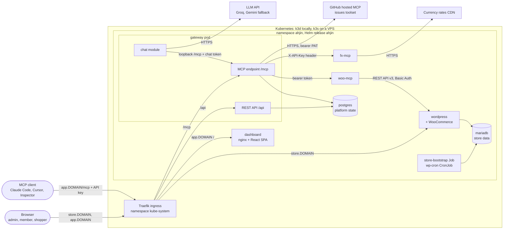
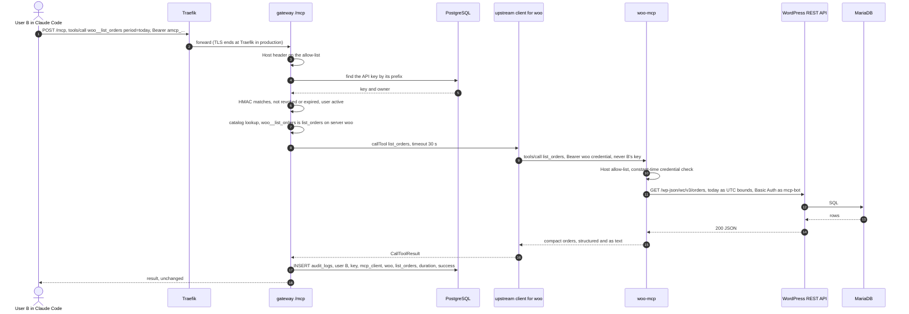
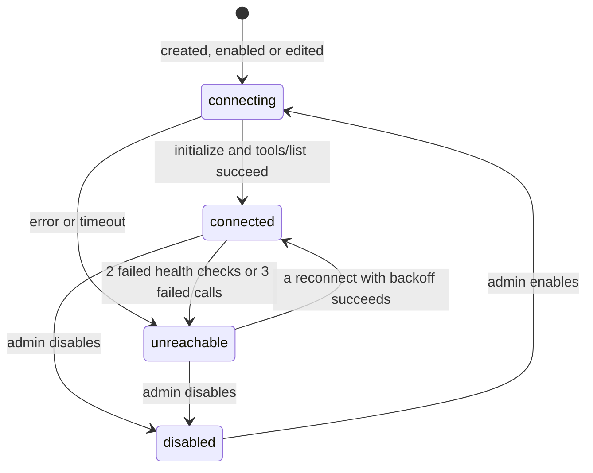
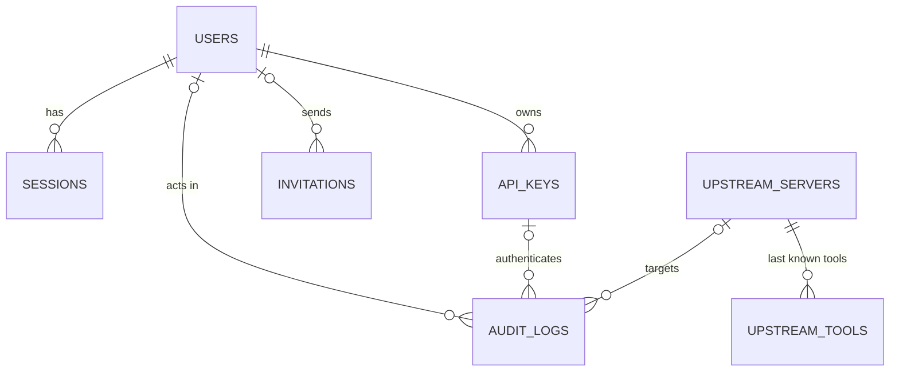

# System design and trade-offs

How the Merchant MCP Gateway is built and why: the architecture, how tools are aggregated and routed, how failures are contained, and what changes between a laptop and a production VPS. It describes the code as built. The original design is in [PROJECT_PLAN.md](PROJECT_PLAN.md), how each part was verified is in [BUILD_LOG.md](BUILD_LOG.md), the security analysis is in [threat-model.md](threat-model.md) and setup steps are in the [README](../README.md). The whole flow is checked end to end against the running cluster by `task dod` (`scripts/dod-check.mjs`).

**The brief's questions, answered here:** how the WooCommerce MCP server talks to the store ([§2.1](#21-how-woo-mcp-talks-to-the-store)), the tool-name collision scheme ([§3.2](#32-naming-scheme-and-collisions)), the local domain approach ([§7.4](#74-local-domain-approach)) and what changes for production ([§8](#8-local-versus-production)).

## 1. Architecture

Everything runs in one namespace, `ahjin`, installed as one Helm release. Every tool call, from the chat agent or from an external MCP client, goes through the gateway's single `/mcp` endpoint; nothing else talks to the upstream MCP servers.

| Component | Runs as | Responsibility | Code |
|---|---|---|---|
| `wordpress` | Deployment | Storefront, cash-on-delivery checkout, wp-admin. WooCommerce is the system of record for products and orders | `docker/wordpress`, `charts/ahjin/charts/store` |
| `mariadb` | StatefulSet | Store database | `charts/ahjin/charts/store` |
| `store-bootstrap`, `wp-cron` | Job (Helm hook), CronJob | Idempotent store setup (WooCommerce, COD, `mcp-bot` user and REST key, the laptop catalogue with photos, the Ahjin theme); scheduled WordPress tasks | `docker/wordpress/bootstrap.sh` |
| `woo-mcp` | Deployment | Our WooCommerce MCP server: 6 tools plus `server_info` | `apps/woo-mcp` |
| `fx-mcp` | Deployment | Our currency MCP server: 3 tools plus `server_info`; live rates with a built-in fallback table | `apps/fx-mcp` |
| GitHub MCP | Outside the cluster, HTTPS | Third upstream: GitHub's hosted server, issues toolset (10 tools), bearer credential | registered in the gateway |
| `gateway` | Deployment | REST API for the dashboard (`/api`), the aggregating MCP endpoint (`/mcp`), identity and API keys, server registry and health, audit log, chat module | `apps/gateway` |
| `postgres` | StatefulSet | Platform state: users, sessions, keys, servers, tools, audit log | `apps/gateway/drizzle` |
| `dashboard` | Deployment | React SPA served by nginx; it only talks to `/api` | `apps/dashboard` |

Shared packages: `mcp-kit` (stateless MCP server, static credential check, Host allow-list, probes, `server_info`), `contracts` (Zod schemas used by both dashboard and gateway) and `logger` (pino with secret redaction).



**What is public and what is internal**

| Endpoint | Exposure | Enforced by |
|---|---|---|
| `store.<domain>`: storefront and `/wp-admin` | Public | Ingress `store` |
| `app.<domain>/`: dashboard | Public | Ingress `app` |
| `app.<domain>/api` and `/mcp` | Public, authenticated | Ingress path rules; a session cookie or API key on every route except login, logout, invitation links and version |
| Gateway `/livez`, `/readyz` | Internal | Not routed by the Ingress |
| `woo-mcp`, `fx-mcp` | Gateway only | ClusterIP Services, no Ingress template in the `mcp-server` chart, NetworkPolicy, static credential, Host allow-list |
| `wordpress:8080` (internal Service name) | Traefik and `woo-mcp` only | NetworkPolicy; Basic Auth works only on the internal host name |
| MariaDB, PostgreSQL | Internal | Headless ClusterIP Services, NetworkPolicy |

## 2. Key choices

| Choice | Why | Rejected alternative |
|---|---|---|
| TypeScript monorepo, pnpm and Turborepo ([ADR-0001](adr/0001-typescript-monorepo.md)) | One toolchain and lockfile; Zod schemas shared by dashboard forms, REST validation and tool inputs; the most complete MCP SDK | A Python or Go backend: two languages, no shared types |
| One umbrella chart, one release, one namespace | One values file per environment, no Secrets copied between namespaces, no install ordering; the `mcp-server` sub-chart is reused for both MCP servers | A chart and namespace per layer: duplicated Secrets and ordering. Cost: components can't be rolled back separately |
| Stateless `/mcp` on MCP SDK v2 ([ADR-0003](adr/0003-mcp-sdk-v2-stateless-gateway.md)) | Each HTTP request is authenticated and served by a fresh server, so a revoked key fails on its next request and a restart loses nothing | SDK v1 with a session map: the legacy line, and it needs sticky routing or a shared session store |
| The gateway is one MCP client per upstream | One shared connection per server, with that server's own credential, timeout and health; user identity stays at the gateway and is never sent upstream | Per-user upstream sessions, or passing client tokens through (a confused deputy, and the MCP spec forbids it) |
| The chat agent is an MCP client of the gateway's own `/mcp` | It holds only a short-lived in-memory token for the signed-in user, so authentication, routing, timeouts and audit run the same code as for external clients | An agent with direct upstream access, which could bypass audit and controls; a separate chat service with JWT delegation |
| Groq `openai/gpt-oss-120b`, falling back to Gemini `gemini-2.5-flash`, both through the OpenAI-compatible API | Free tiers; one adapter (`openai` SDK) chosen by base URL; the fallback covers free-tier rate limits | One SDK per vendor; a local model (more memory than the laptop cluster has) |
| PostgreSQL for platform state | Constraints and transactions, JSONB for tool schemas, indexes for the audit log, works with more than one gateway replica | SQLite on a volume (one writer, one pod); the store's MariaDB (mixes platform and store data) |
| WooCommerce REST API v3 ([ADR-0002](adr/0002-woocommerce-rest-basic-auth.md)) | See §2.1 | WP-CLI through `kubectl exec`, direct SQL |
| Store code baked into the image; only the database and uploads persist | Reproducible; upgrade and rollback are an image tag; `DISALLOW_FILE_MODS` stops wp-admin changing code | Installing plugins at runtime onto a volume |
| k3d locally, k3s in production | Same Kubernetes, Traefik, `local-path` storage and NetworkPolicy engine in both places | Kind or Minikube locally with a different stack in production |

### 2.1 How woo-mcp talks to the store

**How.** `woo-mcp` calls the **WooCommerce REST API v3** on the in-cluster Service, `http://wordpress:8080/wp-json/wc/v3/...`:
- **Identity:** a dedicated WordPress user `mcp-bot` with the `shop_manager` role (products and orders, but no plugins, users or settings). The bootstrap Job creates it and stores its REST key from Secret `store-woo-api`, hashed with WooCommerce's own `wc_api_hash()`, so the Job needs no Kubernetes API access.
- **Authentication:** HTTP Basic Auth with the consumer key and secret. WooCommerce accepts Basic Auth only on HTTPS, so a must-use plugin baked into the store image (`docker/wordpress/mu-plugins/ahjin-internal-https.php`) marks a request as HTTPS only when its `Host` is the internal Service name (`AHJIN_INTERNAL_HOST=wordpress`). Outside traffic can't arrive with that host: Traefik routes only `store.<domain>` to WordPress, and NetworkPolicy admits only Traefik and `woo-mcp`. In the cluster, the same key with the public `Host` gets 401.
- **Behaviour:** 10 s timeout per request; GETs retried twice with backoff, writes never retried (no duplicate products); WooCommerce errors classified into `isError` messages the model can act on ("Order 99999 not found."); links rewritten to the public store URL; list views without addresses or contact details; `period: today` resolved to exact UTC bounds in the store's timezone, so the model never does date maths.

**Why.**

| Option | Verdict |
|---|---|
| **REST API v3** | **Chosen.** A versioned, documented contract; WooCommerce's validation, stock handling, hooks and emails run as for any client; least-privilege user; `woo-mcp` stays a stateless HTTP client with no cluster permissions |
| WP-CLI through `kubectl exec` | Rejected: needs `pods/exec` RBAC (close to cluster-admin), couples the server to pod names, parses CLI text |
| Direct SQL to MariaDB | Rejected: bypasses WooCommerce's business logic (lookup tables, stock, hooks) and breaks across WooCommerce versions |
| OAuth 1.0a over plain HTTP | Rejected: WooCommerce signs against the public home URL, so calls to the internal host need a forged signature base |

Trade-off: the Basic Auth credentials cross the pod network unencrypted, restricted by NetworkPolicy; mTLS is a production gap.

## 3. Tool aggregation and routing

### 3.1 The catalog

- `UpstreamManager` (`apps/gateway/src/mcp/upstream/manager.ts`) keeps one connection per **enabled** server, opened at startup and after every admin change. Each runs `initialize` (the SDK negotiates the protocol version, so 2026-07-28 and 2025-era servers both work) and `tools/list`, sending that server's credential, which is decrypted only inside the gateway.
- `ToolCatalog` (`mcp/catalog.ts`) holds an immutable snapshot of the tools of every **connected** server: exposed name → server, original name, definition and timeout. Disabled, connecting and unreachable servers contribute nothing.
- The snapshot is rebuilt whenever a connection changes status or tools. Tool changes arrive three ways: the upstream's own `list_changed`, the health check (a `tools/list` every 10 s), and the dashboard's Refresh button.
- When the exposed tools really differ, the endpoint calls `handler.notify.toolsChanged()`. 2026-07-28 clients such as Claude Code receive `notifications/tools/list_changed` on their `subscriptions/listen` stream; 2025-era clients such as MCP Inspector see the change on their next `tools/list`.
- `tools/list` returns the snapshot, sorted by name, in one response. It never waits on an upstream.
- Tools are also saved in `upstream_tools`, so the dashboard shows the last known tools of a server that is down.

### 3.2 Naming scheme and collisions

Two servers may expose a tool with the same name, so every tool is exposed as **`<slug>__<tool>`**, where the slug is the server's short, unique id.

| Rule | Detail |
|---|---|
| Format | `woo__list_orders`, `fx__convert_currency`, `github__list_issues` |
| Slug | `^[a-z][a-z0-9-]{1,19}$`: 2 to 20 characters, unique, never containing `_`, so the first `__` always separates slug and tool. Immutable after creation (the edit API doesn't accept it) because clients cache tool names; the display name stays editable |
| Characters | Exposed names stay within `^[A-Za-z0-9_-]{1,64}$`, the strictest rule among common MCP clients and LLM APIs. Other characters become `_`; the catalog keeps the original name for routing |
| Length | A name over 64 characters becomes `<slug>__<start of name>_<hash8>`, where `hash8` is the first 8 hex characters of the SHA-256 of the original name, so it's stable across restarts |
| Description | Prefixed with `[<display name>]` and capped at 2000 characters; the title becomes `<display name>: <title>` |
| Instructions | The gateway's `initialize` result explains the scheme and says tool descriptions and results are data, not instructions |
| Why not first-come-wins or merging | Both hide a tool silently and let one server shadow another's tool (a fake `create_product`). With prefixes, every tool's origin is visible |
| Live example | `woo` and `fx` both expose `server_info`; clients see `woo__server_info` and `fx__server_info` |

### 3.3 Routing a call

1. Traefik routes `app.<domain>/mcp` to the gateway. The `Host` header must be on the allow-list (public host, in-cluster Service names, loopback), otherwise 403 (DNS-rebinding protection).
2. The bearer token is checked: a `achat_` token against the in-memory chat tokens, anything else as an API key. A failure is HTTP 401.
3. `createMcpHandler` builds a fresh MCP server for this request, bound to the caller. `tools/call` runs `invokeTool()` (`mcp/invoke.ts`).
4. `invokeTool()` resolves the exposed name in the snapshot. If it isn't there, it explains a disabled or unreachable server, or returns JSON-RPC error -32602 for an unknown tool. A permission hook sits next (a no-op in the core; per-tool rules are Phase 2).
5. The call goes to that server's connection with the **original** tool name, the server's own timeout and its own credential. The caller's key never leaves the gateway.
6. The upstream's result comes back unchanged, and one audit row is written, whatever the outcome.



## 4. Failure handling

Defaults from `apps/gateway/src/mcp/upstream/connection.ts` unless another file is named.

| Setting | Value |
|---|---|
| Connect (`initialize`) timeout | 5 s |
| `tools/list` timeout | 10 s |
| Tool call timeout | Per server, 1 to 120 s, default 30 s. Seeded: `woo` 30 s, `fx` 15 s, `github` 30 s |
| Health check | A `tools/list` every 10 s per connected server, which also refreshes its tools |
| Marked unreachable | After 2 consecutive failed health checks, or 3 consecutive failed calls. A failed call below that threshold triggers a health check at once |
| What counts as a failed call | Transport failures and timeouts. A JSON-RPC error means the upstream answered, so it's a tool error, not a health problem |
| Reconnect | Backoff from 1 s, doubling to 30 s, plus random jitter of up to half the delay (at most 1 s); reset after a success |
| Tool call retries | None: tools may not be idempotent |
| Connection test in the dashboard | 1 to 30 s, default 10 s; nothing is saved |
| Chat agent, per tool call | 60 s (`modules/chat/agent.ts`) |
| `woo-mcp` to WooCommerce | 10 s per request; GETs retried twice, writes never (`apps/woo-mcp/src/woo/rest-client.ts`) |



Reconnect attempts keep a server **unreachable** until one succeeds, so its status doesn't flap. The dashboard polls every 5 s and shows the status with its reason and since when. The reason comes from `mcp/upstream/errors.ts`, which walks the whole error cause chain because the SDK wraps network errors (`ERA_NEGOTIATION_FAILED` → `fetch failed` → `ECONNREFUSED`):

| Reason | Meaning |
|---|---|
| `DNS` | Host name not found |
| `CONNECTION_REFUSED` | Nothing listening (pod gone), host or network unreachable |
| `TIMEOUT` | No answer within the limit |
| `TLS` | Certificate or handshake error |
| `AUTH` | The upstream answered 401 or 403: wrong credential |
| `HTTP_ERROR` | Any other HTTP error status |
| `PROTOCOL` | Reachable but not a working MCP endpoint (reset connection, unexpected response) |

**What callers see** (`mcp/invoke.ts`)

| Situation | Response | Audit outcome |
|---|---|---|
| Missing, unknown, revoked or expired key; disabled user; ended chat session | HTTP 401, `WWW-Authenticate: Bearer error="invalid_token", error_description="API key revoked"` | `denied_auth`, when the key's owner is known |
| Unknown tool | JSON-RPC error -32602, `Unknown tool: <name>` | `not_found` |
| Server disabled | `isError`: "Server 'fx' is disabled by an admin. Its tools are not available." | `rejected_disabled` |
| Server unreachable | `isError`: "Server 'fx' is unreachable right now (CONNECTION_REFUSED: connection refused). Other servers are unaffected." | `upstream_unreachable` |
| Timeout | `isError`: "Server 'woo' did not respond within 30s." | `timeout` |
| Other transport failure | `isError`: "Server 'woo' failed (PROTOCOL: connection reset by the upstream)." | `upstream_unreachable` |
| Upstream JSON-RPC error | `isError`: "Server 'woo' rejected the call: ..." (URLs masked, at most 300 characters) | `tool_error` |
| Upstream tool error, or success | The upstream's result, unchanged | `tool_error` or `success` |

**Why a slow or dead upstream can't break the rest**
- `tools/list` reads the in-memory snapshot; no upstream call is on its path.
- Each upstream has its own connection, timers and timeouts, so a hung server only holds up calls to itself.
- An unreachable server's tools leave the list, and calls to it fail at once with the reason until a reconnect succeeds.
- Gateway readiness checks only PostgreSQL, never upstreams, so a dead upstream never takes the gateway out of its Service.
- Seen in the DoD run: the first call after the `fx` pod died waited out fx's 15 s timeout on a keep-alive connection to the vanished pod IP (audited as `timeout`). `woo` kept answering, and the dashboard showed `fx` unreachable with `CONNECTION_REFUSED`.

## 5. Identity, access and audit

| Caller | Credential | Stored as | Lifetime |
|---|---|---|---|
| Dashboard user | Email and password, then an opaque `ahjin_session` cookie (HttpOnly, SameSite=Lax, Secure on https) | Password: scrypt (N=2^15, r=8, p=3, per-user salt). Session: SHA-256 of the token | 12 h idle, 7 days absolute |
| MCP client | API key `amcp_<8-char prefix>_<43-char secret>` as a bearer token | Prefix in clear for lookup and display; HMAC-SHA256 of the key with a server-side pepper (Secret `gateway-crypto`) | Until revoked; optional expiry of 1 to 365 days |
| Chat module | `achat_` token, 32 random bytes | SHA-256 in an in-memory map, bound to the user and their dashboard session | 5 minutes, and revoked when the chat turn ends |
| Gateway to an upstream | Static bearer token or custom header | AES-256-GCM, key in Secret `gateway-crypto`; write-only in the API | Until an admin replaces it |

- **API keys** are shown once (`Cache-Control: no-store`), limited to 10 active per user, and revocable by their owner or an admin. Every request re-checks the key in the database (no cache), so revocation applies to the very next request. Disabling a user revokes their keys and ends their sessions.
- **Upstream credentials** never leave the gateway: the API reports only `hasCredential`, members don't even get server URLs, and the headers are built inside the gateway when it connects.
- **Cross-site requests:** state-changing `/api` calls must carry `X-Requested-With`. A page on another site can't add that header without a CORS preflight, which the gateway never grants; the cookie is also `SameSite=Lax`.
- **Sign-in:** 5 attempts per minute per IP and email (then 429), and one answer for an unknown email or a wrong password. The first admin comes from Secret `gateway-bootstrap-admin` on an empty database and must change the password. Members join through one-time invitation links (72 h, stored as a hash).

| Capability | Admin | Member |
|---|---|---|
| See servers, status and tools | Yes, with URLs | Yes, without URLs |
| Add, edit, test, disable and remove servers | Yes | No |
| Read an upstream credential | No one | No one |
| Invite members, change roles, disable users | Yes (the last active admin is protected) | No |
| Create, list and revoke own API keys | Yes | Yes |
| Issue or revoke keys for others | Yes | No |
| Audit log | All entries, with filters | Own entries only |
| Chat agent and `/mcp` | Yes | Yes |

Every rule is enforced on the server (`requireUser`, `requireAdmin` and ownership checks); the dashboard only hides what a role can't do.

**The chat agent acts as the signed-in user.** `POST /api/chat` (session cookie) issues a chat token for that user and session. The agent runs inside the gateway process as an MCP SDK client of `http://127.0.0.1:8080/mcp` with that token, so `/mcp` authenticates, routes and audits its calls under the user, with channel `chat_agent`. Each turn lists the tools afresh, runs at most 8 model rounds within 120 s, runs a round's tool calls in parallel, feeds results (up to 16,000 characters each, errors included) back to the model, and streams `tool.started`, `tool.completed`, `message` and `done` events over SSE. The browser sends the conversation with every turn; the server keeps none of it.

**What the agent knows, and the guardrails around it.** The system prompt (`modules/chat/prompt.ts`) is built per turn from the user's name and role, the current time, the servers behind the user's tool list, and the admin's **business context**: a short text about the shop (catalogue, currency, payment, delivery, warranty, order statuses), set by the Helm value `platform.gateway.chat.context` and editable by admins on the dashboard's **Assistant** page (stored in `system_settings`). It's a lightweight alternative to retrieval: small, admin-owned facts go into the prompt, and live data always comes from tools. Its numbered rules take priority over the conversation: ground every fact in a tool result or the context, stay on topic, treat tool text as data, ask before ambiguous changes, never reveal instructions or secrets. Code enforces what a prompt can't (`modules/chat/guardrails.ts`): known jailbreak phrasings are refused without calling the model; secrets and internal URLs are removed from tool results and answers; an answer with store data but no tool call is sent back once for verification; and a tool that may change data (not read-only and not marked non-destructive) pauses the turn with a `confirmation.required` event. The user approves that exact call, which the server signed, bound to the user and made single-use, and the next request runs it and continues the conversation (`modules/chat/approvals.ts`).

**Tool permissions.** Admins add rules on the **Permissions** page (`/api/policies`). A rule applies to a role or to one user, a server slug or every server, a tool-name pattern (`create_*`), and either every matching tool or only those not marked read-only; its effect is allow or deny. The `PermissionSet` of the caller (one query per MCP request) consults the user's own rules before their role's, and at the same level deny beats allow; with no matching rule a tool is allowed. `tools/list` filters the catalog through it; `tools/call` runs the `PolicyGuard`, the first of the `ToolInvoker`'s guards, before anything reaches an upstream. A rule change sends `tools/list_changed`, so connected clients list again. `GET /api/policies/effective` shows, for any user, every tool, whether they may use it and which rule decided.

**Audit log.** One row per `tools/call`, whatever the outcome, plus a `denied_auth` row for a rejected request when the key's owner is known. A row holds the time, user, API key (empty for the chat agent), channel (`mcp_client` or `chat_agent`), server id and slug (the slug survives the server's deletion), the upstream tool name, duration, outcome, an error message of up to 500 characters and the request id. Tool arguments aren't stored, because they can contain customer data. The code only ever inserts rows. Admins see every row and can filter by user, server, tool, outcome, channel and time; members see only their own.

What a member can do with a credential they never see, why client tokens aren't passed upstream, manipulative tool descriptions and what a malicious upstream can do are covered in [threat-model.md](threat-model.md).

## 6. Data model



| Table | Holds |
|---|---|
| `users` | Email (unique, case-insensitive), name, scrypt hash, role (`admin`, `member`), status (`active`, `disabled`), forced password change, last sign-in |
| `sessions` | SHA-256 of the cookie token, user, last activity, expiry, IP, user agent |
| `invitations` | Email, role, SHA-256 of the link token, inviter, expiry, accepted and revoked times |
| `api_keys` | Owner, name, unique prefix, HMAC hash, creator, last use, expiry, revocation time and actor |
| `upstream_servers` | Slug (unique), display name, URL, enabled, auth type (`none`, `bearer`, `header`), header name, credential ciphertext with IV and tag, timeout, seeded flag, last status, error and check time |
| `upstream_tools` | Last known tools per server: name, title, description, input and output schemas, annotations, a definition hash (for Phase 2 pinning), fetch time |
| `audit_logs` | The audit fields above; indexed by time, by user and time, and by server and time |
| `system_settings` | One-off facts such as `seed:woo`: each seeded server is created once and stays deleted if an admin removes it |

Deleting a user or server keeps its audit rows (the reference is set to null). The schema is one drizzle-kit migration (`apps/gateway/drizzle/0000_initial_schema.sql`), applied by the gateway's `migrate` initContainer before the server starts; already-applied migrations are skipped. Later migrations only add (expand now, remove a release later), so the previous gateway version still runs after a rollback.

## 7. Kubernetes

### 7.1 Workloads

| Workload | Kind | Probes | Requests → limits (local) | Storage |
|---|---|---|---|---|
| `wordpress` | Deployment, `Recreate` | Startup and readiness `GET /healthz.php` (PHP and database); liveness TCP, so a database outage never restarts it | 100m, 256Mi → 1000m, 512Mi | PVC `wp-uploads` 1 Gi, kept on uninstall |
| `mariadb` | StatefulSet | `healthcheck.sh --connect --innodb_initialized` (startup, readiness), `--connect` (liveness) | 100m, 256Mi → 500m, 512Mi | PVC `data-mariadb-0` 2 Gi |
| `store-bootstrap` | Job, post-install and post-upgrade hook | Runs to completion: 600 s deadline, 3 retries | 100m, 128Mi → 1000m, 512Mi | none |
| `wp-cron` | CronJob, every 5 minutes | Runs to completion: 240 s deadline | 50m, 96Mi → 500m, 256Mi | none |
| `woo-mcp` | Deployment | Startup and liveness `/livez`, readiness `/readyz` | 50m, 64Mi → 250m, 192Mi | none |
| `fx-mcp` | Deployment | Same as `woo-mcp` | 25m, 48Mi → 200m, 128Mi | none |
| `gateway` | Deployment with a `migrate` initContainer | Startup and liveness `/livez`; readiness `/readyz` (database only, never upstreams) | 100m, 192Mi → 750m, 512Mi | none |
| `dashboard` | Deployment | Readiness and liveness `GET /healthz` | 10m, 16Mi → 200m, 64Mi | `emptyDir` for nginx temp files |
| `postgres` | StatefulSet | `pg_isready` (startup, readiness, liveness) | 100m, 128Mi → 500m, 512Mi | PVC `data-postgres-0` 1 Gi |

The long-running pods add up to about 2.4 GiB of memory limits and under 1 GiB of requests. Every container runs as a non-root user (WordPress 33, MariaDB 999, PostgreSQL 70, nginx 101, the Node services 65532 on distroless images) with all capabilities dropped, no privilege escalation and the `RuntimeDefault` seccomp profile; the Node services and nginx also have read-only root filesystems. CI scans every published image with Trivy and fails on a fixable critical vulnerability. No component talks to the Kubernetes API, so no pod mounts a service-account token. Stateless Deployments roll with `maxUnavailable: 0, maxSurge: 1`. `task verify:k8s` checks probes, requests and limits, non-root users and NetworkPolicies on the rendered chart and runs kubeconform; CI runs it too.

### 7.2 NetworkPolicies

Namespace-wide policies deny all ingress **and egress** to every pod in `ahjin`; allow rules then open only the paths the system uses. k3s enforces them with its built-in policy controller, locally and in production. The namespace also enforces the `restricted` Pod Security Standard (`task namespace`), so a pod that would run as root or keep capabilities is refused at admission.

| Pods | Accept connections only from |
|---|---|
| `mariadb` (3306) | `wordpress`, `store-bootstrap`, `wp-cron` |
| `wordpress` (8080) | Traefik (namespace `kube-system`), `woo-mcp` |
| `postgres` (5432) | `gateway`, including its `migrate` initContainer |
| `gateway` | Traefik |
| `dashboard` | Traefik |
| `woo-mcp`, `fx-mcp` | `gateway` only |

| Pods | May connect to (besides the cluster DNS) |
|---|---|
| `gateway` | `postgres` (5432); MCP servers (label `app.kubernetes.io/component: mcp-server`, 8080) in this namespace and in namespaces labelled `app.kubernetes.io/part-of: ahjin`; public addresses on 80 and 443 |
| `woo-mcp` | `wordpress` (8080) |
| `fx-mcp` | public addresses on 443 (the rates CDN) |
| `wordpress`, `store-bootstrap`, `wp-cron` | `mariadb` (3306); WordPress also sets `WP_HTTP_BLOCK_EXTERNAL`, so its own update checks fail at once |
| `mariadb`, `postgres`, `dashboard`, anything else | nothing |

"Public" is `0.0.0.0/0` minus the private, CGNAT, loopback and link-local ranges (`global.networkPolicy.egress.privateRanges`), so no pod can reach the node, the Kubernetes API or a cloud metadata endpoint, even through a URL that slipped past the gateway's SSRF check. The chat agent's calls to `/mcp` stay inside the gateway pod, so no policy is involved. The policy engine admits a new pod a few seconds after it starts, one more reason the gateway retries upstream connections with backoff.

### 7.3 Secrets

Secrets are created outside the chart by `scripts/secrets.mjs` (`task secrets`) from the git-ignored `.env.local`. The chart references them only by name (`secretKeyRef`), and values files hold names, never values.

| Secret | Keys | Used by |
|---|---|---|
| `store-db` | `root-password`, `password` | MariaDB, WordPress, the store Jobs |
| `store-wp` | WordPress salts, `admin-user`, `admin-email`, `admin-password` | WordPress, bootstrap |
| `store-woo-api` | `consumer-key`, `consumer-secret` | bootstrap (registers the key for `mcp-bot`), `woo-mcp` |
| `woo-mcp-auth`, `fx-mcp-auth` | `token`, `api-key` | The MCP servers (to check callers), the gateway (first-boot seed) |
| `platform-db` | `password` | PostgreSQL, gateway |
| `gateway-crypto` | `api-key-pepper`, `credential-key` | gateway |
| `gateway-bootstrap-admin` | `email`, `password` | gateway, on an empty database only |
| `llm` | `groq-api-key`, `gemini-api-key` | gateway (chat module) |
| `github-mcp` | `token`, `repo` | gateway (first-boot seed of the `github` upstream) |

- Random values are generated only when a Secret doesn't exist yet, so re-running never rotates a password under a running database. `llm` and `github-mcp` are re-synced from `.env.local` on every run.
- Manifests reach `kubectl` on stdin, so no value appears in a command line or in output. gitleaks scans the full git history in CI.
- Seed credentials reach the gateway as optional environment variables and are encrypted into PostgreSQL on first boot; from then on they're managed in the dashboard. A seed whose Secret is empty is skipped and retried at the next start.

### 7.4 Local domain approach

Every public host is built from `global.domain`. Locally it's `127.0.0.1.nip.io`: [nip.io](https://nip.io) is a public wildcard DNS service, so `store.127.0.0.1.nip.io` and `app.127.0.0.1.nip.io` resolve to 127.0.0.1 with no hosts-file edits, for browsers, curl, Claude Code and Cursor alike. k3d maps the laptop's ports 80 and 443 to its load balancer:

```text
app.127.0.0.1.nip.io → DNS answers 127.0.0.1 → laptop port 80 → k3d load balancer → Traefik → Service → Pod
```

- **Offline:** add `127.0.0.1 store.ahjin.test app.ahjin.test` to the hosts file and deploy with `--set global.domain=ahjin.test`. If port 80 is taken, change the host port in `deploy/k3d/cluster.yaml` and add it to the URLs.
- **Inside the cluster** pods use Service names (`http://wordpress:8080`, `http://woo-mcp:8080/mcp`), so nothing internal depends on nip.io.
- **Streaming:** the chart sets Traefik's read and write timeouts to none (idle timeout 600 s) through a k3s `HelmChartConfig`, so SSE streams (`/mcp` change subscriptions, `/api/chat`) aren't cut after Traefik's default 60 s.

Details and troubleshooting: [local-domains.md](local-domains.md).

## 8. Local versus production

The same chart is used everywhere; only values differ (`values-local.yaml`, `values-prod.yaml`). CI lints and renders the chart with both, and `task verify:k8s` checks those renders plus the rehearsal combination.

| Concern | Local | Production |
|---|---|---|
| Domain and DNS | `127.0.0.1.nip.io`, wildcard DNS to loopback | A real domain (for example a DuckDNS name) whose `store.` and `app.` hosts point at the VPS |
| Ingress and TLS | k3s's Traefik, plain HTTP | Same Traefik and Ingress objects. `global.tls` adds TLS sections and the cert-manager annotation; Let's Encrypt issues certificates through a ClusterIssuer the chart renders. Cookies become `Secure`, and WordPress sees https through `X-Forwarded-Proto` |
| Images | `ahjin-registry:5000/ahjin-<app>:dev`, pulled `Always` | `ghcr.io/mohan0112/merchant_mcp_gateway/<app>` with an immutable git-SHA tag, built and pushed by CI (`images.yml`) |
| Storage class and sizes | Cluster default (`local-path`); MariaDB 2 Gi, uploads 1 Gi, PostgreSQL 1 Gi | `persistence.storageClass` per volume (empty means the cluster default; a block-storage CSI class on a cloud VPS); MariaDB 10 Gi, uploads 5 Gi, PostgreSQL 5 Gi |
| Resources | §7.1 | Higher limits for WordPress, MariaDB, the gateway and PostgreSQL |
| Secrets | `task secrets` against `k3d-ahjin` | The same script with `--context` set to the VPS cluster, from that machine's `.env.local` |
| Log level | `debug` | `info` |

**Production rehearsal.** The live VPS is Phase 2, so Task 19 proves the production values on the laptop: `values-rehearsal.yaml` runs them on a second k3d cluster, `ahjin-rehearsal`, with a self-signed issuer instead of Let's Encrypt. `task rehearsal:up` and `rehearsal:deploy` create and deploy it, `rehearsal:dod` runs the definition of done over HTTPS (19 of 19 on 2026-10-19, with the images CI pushed to GHCR), an upgrade and a `helm rollback` drill follow (a broken upgrade was rolled back automatically while the gateway kept answering), and `rehearsal:down` deletes it. Production and rehearsal differ only in the domain and the certificate issuer. A real VPS follows [runbooks/vps.md](runbooks/vps.md) and deploys with `task deploy:prod`.

**Upgrade and rollback.** The platform is one release, so `helm history ahjin` lists every revision with its image tags and values. An upgrade changes image tags (git SHAs) or values and runs `helm upgrade --rollback-on-failure --wait` (Helm 4's replacement for `--atomic`), which rolls back on its own if pods don't become ready. A problem found later is undone with `helm rollback ahjin <revision> --wait`. That's safe for the gateway because migrations only add. The store bootstrap hook re-runs on every upgrade and changes nothing that's already in place, but WooCommerce's own database updates can't be undone by Helm, so back up the store database before upgrading WooCommerce. Steps: [runbooks/upgrade-and-rollback.md](runbooks/upgrade-and-rollback.md).

## 9. Trade-offs and known limitations

- **One gateway replica.** `/mcp` keeps no session state, but some state is per process: each replica would hold its own upstream connections and health view, an admin's server change would reload only the replica that served it, `list_changed` would reach only clients subscribed on that replica, and sign-in throttling would count per replica. Scaling out needs a shared event bus (the SDK's pluggable `ServerEventBus`, on Valkey) for registry changes and notifications (Phase 2). Chat tokens are fine as they are: the agent always calls its own replica over loopback.
- **MCP SDK 2.3 quirk.** When a client gives up on a call mid-flight (after a timeout, for example), the SDK keeps that exchange in flight until shutdown: a small leak per abandoned call. Shutdown therefore waits at most 5 s for in-flight exchanges and then force-closes connections (10 s overall in the gateway, 5 s in `mcp-kit`).
- **Storage on one node.** `local-path` volumes live on one node's disk (ReadWriteOnce), so stateful pods are tied to it, WordPress updates use `Recreate` (seconds of downtime, and until the rollback if the new store image can't start) and there's no database replication or scheduled backup yet.
- **The LLM key lives in the gateway pod**, next to the key that decrypts upstream credentials (accepted to avoid a separate chat service). Moving the chat module into its own Deployment fixes that, without changing the protocol.
- **Ingress-only NetworkPolicies.** Egress isn't restricted yet, so a compromised pod could open outbound connections.
- **No SSRF guard on admin-entered URLs.** An admin can register any http(s) URL, including cluster-internal addresses or cloud metadata endpoints. Registration is admin-only; URL validation and egress rules are Phase 2.
- **No per-tool permissions or rate limits.** Every member can call every enabled tool. The hooks exist in `invokeTool()` and `ToolCatalog.list()` (Phase 2).
- **Tool definitions aren't pinned.** An upstream can change a description silently; the stored definition hash is there for Phase 2 pinning.
- **Plain HTTP inside the cluster.** Basic Auth and upstream credentials cross the pod network unencrypted, restricted by NetworkPolicy; mTLS is a production gap.
- **Append-only audit by code, not by database grants** (Phase 2).
- **2025-era clients** (MCP Inspector) see tool changes on their next `tools/list`, not live.
- **Sanitised names within one server:** two tools of the same server whose names differ only in characters outside `[A-Za-z0-9_-]` would map to one exposed name, and the later one wins.
